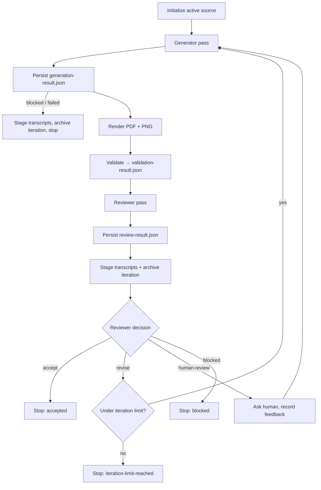

## Shared setup (both profiles)

| Requirement | Check |
|---|---|
| `omp`, Bash, Python 3 | `omp --version`, `python3 --version` |
| TeX + `latexmk` or `lualatex`/`pdflatex` | `command -v latexmk` |
| PDF→PNG | `pdftoppm` or `magick` |
| CircuitTikZ | `kpsewhich circuitikz.sty` |
| Schemabloc | `kpsewhich schemabloc.sty` |
| `uv` | `command -v uv` |
| Pharo 13.1 + base image | for the `dskt` MCP tools |

Optional per-role models: uncomment `modelRoles` in `.omp/config.yml`, then `model: "@generator"` / `model: "@reviewer"` in the agent files, using selectors from `omp models`. Otherwise all agents inherit the parent session model.

### Install and start the `dskt` service

The MCP server itself is launched by omp from `.omp/mcp.json`; the Pharo service is external and must already run. After the cleanup, `tmp/dskt/DsktService.image` is gone, so reinstall once:

```bash
export PHARO="$HOME/pharo-launcher/pharo-vm/pharo"
export DSKT_BASE_IMAGE="/path/to/Pharo13.1.image"
scripts/dskt-install.sh
```

Start it in a dedicated terminal (it blocks):

```bash
scripts/dskt-start.sh
```

or background it:

```bash
mkdir -p tmp/dskt
nohup scripts/dskt-start.sh >tmp/dskt/service.log 2>&1 &
```

Verify:

```bash
curl -s http://127.0.0.1:8087/health | python3 -m json.tool
scripts/png-measure-smoke.sh
scripts/ctikz-tools-smoke.sh
scripts/control-smoke.sh
```

Defaults: `127.0.0.1:8087`. If you change `DSKT_PORT`/`DSKT_HOST`, export the same values for the omp session so `.omp/mcp.json` points at the right service.

## The loop (both profiles)



Generator and Reviewer never run concurrently. The coordinator — not the workers — owns rendering, validation, persistence, and archiving.

---

# 1. Electrical diagram reconstruction

| Item | Path |
|---|---|
| Target | `reference/target.png` |
| Active source | `current/reconstruction.tex` |
| Active results | `current/*.json` |
| Agents | `diagram-generator`, `diagram-reviewer` |
| Workflow files | `workflow/{objective,coordinator,generator-instructions,reviewer-instructions,completion-criteria,current-human-feedback}.md` |
| Archives | `iterations/iteration-NNN/` |
| Launcher | `scripts/run.sh` |

### Step 1 — Supply the target

```bash
cp /path/to/your/electrical-diagram.png reference/target.png
```

Must be a single, readable, correctly oriented PNG. It is treated as immutable and must never be embedded in the output.

### Step 2 — Launch

```bash
scripts/run.sh
```

This runs `scripts/init-current.sh` (copies `input/initial-reconstruction.tex` to `current/reconstruction.tex` only if absent), `scripts/check-workspace.sh`, then starts omp with:

```text
@workflow/coordinator.md
@workflow/objective.md
"Execute the sequential CircuitTikZ generator-reviewer workflow exactly as specified."
```

Manual equivalent:

```bash
scripts/init-current.sh
scripts/check-workspace.sh
omp @workflow/coordinator.md @workflow/objective.md \
  "Execute the sequential CircuitTikZ generator-reviewer workflow exactly as specified."
```

Interactive/bounded variant inside omp:

```text
/goal Execute the workflow in workflow/coordinator.md until it is accepted,
human input is required, a blocker occurs, or the iteration limit is reached.
/goal budget 120000
```

The budget is a project decision, not an acceptance criterion.

### Step 3 — What each iteration does

The coordinator delegates one pass to `diagram-generator`, which reads the objective, criteria, instructions, domain rules, human feedback, current source, and prior results, then edits `current/reconstruction.tex`. Its prompt is `.omp/agents/diagram-generator.md`; you do not type it.

Then the coordinator runs:

```bash
# persist the exact structured Generator result
scripts/persist-result.sh \
  tmp/generation-result.candidate.json \
  current/generation-result.json \
  schemas/generation-result.schema.json

# render
scripts/render.sh

# deterministic checks; writes current/validation-result.json
scripts/validate.sh

# persist the Reviewer result
scripts/persist-result.sh \
  tmp/review-result.candidate.json \
  current/review-result.json \
  schemas/review-result.schema.json

# stage subagent transcripts (direct shell only; history:// does not resolve in a script)
mkdir -p tmp/transcripts/generator tmp/transcripts/reviewer
cat history://<generator-agent-id> > tmp/transcripts/generator/NN-<generator-agent-id>.md
cat history://<reviewer-agent-id> > tmp/transcripts/reviewer/NN-<reviewer-agent-id>.md

# archive regardless of decision
scripts/archive-iteration.sh
```

Add the transcript front matter (`iteration`, `role`, `agent`, `agentKind`, `agentStatus`, `resultArtifact`, `source`) before archiving. Every agent that touched the iteration gets a file, including discarded passes.

Circuit validation checks: source exists, `circuitikz` is loaded, a complete `circuitikz` environment exists, the target is not referenced, PDF and PNG exist. A nonzero `scripts/validate.sh` exit is evidence, not a crash, when `current/validation-result.json` was written and validates.

### Step 4 — Human review

If the Reviewer returns `human-review`, edit while preserving the heading:

```markdown
# Current human feedback

The upper-right Z_g block is split into two rectangles; it is one block.
Move it left so its right edge aligns with the G_Lf block.
```

Then tell the coordinator:

```text
Feedback is recorded in workflow/current-human-feedback.md.
Archive it with the next iteration and continue.
```

### Step 5 — Acceptance

Stop as accepted only when all hold:

1. `current/reconstruction.tex` exists and is non-empty.
2. CircuitTikZ is the primary mechanism.
3. The document compiles.
4. `current/reconstruction.pdf` and `.png` exist and are non-empty.
5. `current/validation-result.json` reports `passed`.
6. The Reviewer returns `accept`.
7. No critical or major findings remain.
8. Human feedback is addressed.
9. The accepted iteration is archived.

Limit: 10 archived iterations. Reaching it is not success.

Artifacts: `current/reconstruction.{tex,pdf,png}`, `current/{generation,validation,review}-result.json`, `iterations/iteration-NNN/`, `session-transcript.md` at the end of a session.

---

# 2. Control block-diagram reconstruction

| Item | Path |
|---|---|
| Target | `reference/control_diagram.png` |
| Seed | `input/control-initial.tex` |
| Active source | `current-control/reconstruction.tex` |
| Active results | `current-control/*.json` |
| Agents | `control-generator`, `control-reviewer` |
| Workflow files | `workflow/control/*` |
| Archives | `iterations-control/iteration-NNN/` |
| Launcher | `scripts/control/run.sh` |

### Step 1 — Supply the target

```bash
cp /path/to/your/control-diagram.png reference/control_diagram.png
```

### Step 2 — Launch

```bash
scripts/control/run.sh
```

It runs `scripts/control/init-current.sh` (copies `input/control-initial.tex` to `current-control/reconstruction.tex` if absent), `scripts/control/check-workspace.sh`, then:

```text
@workflow/control/coordinator.md
@workflow/control/objective.md
"Execute the sequential schemabloc control-diagram generator-reviewer workflow exactly as specified."
```

Manual equivalent:

```bash
scripts/control/init-current.sh
scripts/control/check-workspace.sh
omp @workflow/control/coordinator.md @workflow/control/objective.md \
  "Execute the sequential schemabloc control-diagram generator-reviewer workflow exactly as specified."
```

Bounded goal inside omp:

```text
/goal Execute the workflow in workflow/control/coordinator.md until it is accepted,
human input is required, a blocker occurs, or the iteration limit is reached.
/goal budget 120000
```

### Step 3 — What each iteration does

`control-generator` (prompt: `.omp/agents/control-generator.md`) revises `current-control/reconstruction.tex` using `\sbEntree`, `\sbBloc`, `\sbComp`, `\sbRelier`, `\sbSortie`, and feedback/branch macros where applicable. It must use the Schemabloc catalog/lint tools and measure both images before geometry claims.

Coordinator commands:

```bash
scripts/persist-result.sh \
  tmp/control/generation-result.candidate.json \
  current-control/generation-result.json \
  schemas/generation-result.schema.json

scripts/control/render.sh

scripts/control/validate.sh

scripts/persist-result.sh \
  tmp/control/review-result.candidate.json \
  current-control/review-result.json \
  schemas/review-result.schema.json

mkdir -p tmp/control/transcripts/generator tmp/control/transcripts/reviewer
cat history://<generator-agent-id> > tmp/control/transcripts/generator/NN-<generator-agent-id>.md
cat history://<reviewer-agent-id> > tmp/control/transcripts/reviewer/NN-<reviewer-agent-id>.md

scripts/control/archive-iteration.sh
```

`scripts/control/validate.sh` is different from the circuit validator: it POSTs `{"path":"current-control/reconstruction.tex","required_labels":[]}` to `/schemabloc/lint` and **fails closed** if the service is unavailable. Its checks are: source exists, Schemabloc lint has zero failed checks, PDF exists, PNG exists. The service must be running before validation.

`scripts/control/render.sh` fails early if `kpsewhich` or `schemabloc.sty` is missing.

### Step 4 — Human review

Same protocol, with the control file:

```bash
$EDITOR workflow/control/current-human-feedback.md
```

Then tell the coordinator to archive it with the next iteration and continue.

### Step 5 — Acceptance

Same conditions as the circuit profile, with:

- `current-control/reconstruction.tex` and rendered PDF/PNG;
- `scripts/control/validate.sh` returns `passed`, including zero failed Schemabloc lint checks;
- Reviewer `accept` with no critical/major findings;
- the iteration archived under `iterations-control/`.

Limit: 10 archived control iterations.

---

## Operating rules

- Do not run the two profiles concurrently: they share `logs/` and the `dskt` service, and archives copy the shared logs.
- `scripts/*/init-current.sh` never overwrites an existing active source. Re-running a `run.sh` resumes from the current state.
- `iterations/` and `iterations-control/` are immutable once archived. `archive-iteration.sh` refuses to overwrite.
- The Generator has no Bash tool; the Reviewer is read-only. Only the coordinator runs shell commands and persists JSON.
- The target must be inspected as an image. If the model/session cannot inspect images, the Generator/Reviewer must return `blocked`; do not proceed on guesses.
- Treat a nonzero `validate.sh` exit as a failed check when `validation-result.json` exists and is schema-valid.

## Optional efficiency pass (retained)

Only after at least one iteration is archived:

```text
Run workflow/efficiency-analysis.md over the archived iterations.
```

It uses:

```bash
scripts/persist-result.sh \
  tmp/efficiency-report.candidate.json \
  analysis/efficiency-through-NNN.json \
  schemas/efficiency-report.schema.json

scripts/render-efficiency-report.py analysis/efficiency-through-NNN.json
```

The analyst is read-only and applies nothing; it proposes tool-shaped repetition with per-occurrence evidence.

## Quick reference

```bash
# Circuit
scripts/run.sh
scripts/render.sh
scripts/validate.sh
scripts/archive-iteration.sh

# Control
scripts/control/run.sh
scripts/control/render.sh
scripts/control/validate.sh
scripts/control/archive-iteration.sh

# Shared
scripts/init-current.sh                 scripts/control/init-current.sh
scripts/check-workspace.sh              scripts/control/check-workspace.sh
scripts/next-iteration-number.sh        scripts/control/next-iteration-number.sh
scripts/persist-result.sh
```
