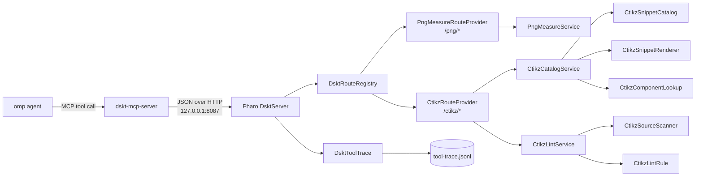

# CircuitTikZ snippet catalog and source lint — implementation plan

Status: proposal (not implemented).

Implements tool proposals 2 and 3 from `analysis/efficiency-through-003.md`, with the final catalog design agreed in conversation:

- many small, reusable snippets instead of one document generator;
- no loop template and no pre-filled diagram labels;
- rectangle and diagonal aggregated into one generic AC/DC converter snippet;
- a single generic label snippet;
- the source linter (`lint_reconstruction_tex`) implemented as `ctikz_lint_source`;
- both tools use the common **Domain Specific Toolkit (`Dskt`)**, extracted from the existing PNG measurement server, as the MCP/HTTP/image infrastructure;
- the `Dskt` layer has no dependency on PNG, CircuitTikZ, or any other domain package.

Tool proposal 1 (`measure_diagram_geometry`) is already implemented as `png-diagram-measure`; this plan does not modify it.

## 1. Decisions

| Decision | Choice | Why |
|---|---|---|
| Where the work happens | Catalog, Mustache rendering, source scanning, and lint rules run in the Pharo image. The MCP process is a transport shim only. | Keeps one implementation of each rule and lets the image hold the editable catalog. |
| Server | Common `DsktServer` on `DSKT_PORT` (default 8087), with domain route providers for `/png/*` and `/ctikz/*`. No second Pharo process or port. | One lifecycle, one trace, one health surface; domains remain independently registerable. |
| Pharo packages | `Dskt-Core` for common infrastructure; `PngDiagramMeasure-Core` for the existing PNG domain; `Ctikz-Core` for the new catalog/lint domain. | Enforces the rule that `Dskt` imports no domain package; domains depend on `Dskt`. |
| MCP surface | One `dskt-mcp-server` with domain modules; it exposes `png_*`, `ctikz_*`, `dskt_health`, and `dskt_trace`. `DSKT_MODULES` and `DSKT_TOOLS` filter what each process registers. | The MCP shim is common infrastructure, not a PNG-specific package; a filtered process can expose only one agent's tools. |
| Naming | Common packages/classes use the `Dskt` prefix (`DsktServer`, `DsktSettings`, `DsktToolTrace`, `DsktError`). Domain classes keep `PngMeasure` or `Ctikz`. | Keeps the shared layer identifiable and prevents domain names from leaking into the toolkit. |
| Catalog shape | Snippets, not documents. Each renders one construct with abstract parameters. | The agent decides composition; the image does not assume a target diagram. |
| AC/DC converter | One `component/ac-dc-converter` snippet renders both the rectangle and the diagonal. No separate rectangle or diagonal entries. | The two are only useful together as a converter block; a bare diagonal is still possible through `component/line`. |
| Labels | One `label/generic` snippet. No `L_f`, `R_f`, `Z_g`, `GFM converter`, `grid`, or other target labels baked into a template. | Labels are diagram-specific; the agent supplies text and position. |
| Template engine | Mustache, with a logic-less template and a Pharo-built view model. | Templates remain readable and editable; optional attributes and computed values are prepared in Pharo. |
| Source parsing | A purpose-built comment-aware scanner, not a full TeX engine and not tree-sitter. | The checks are structural; a full parser plus macro expansion is unnecessary. Tree-sitter Pharo parses Smalltalk, not TeX. |
| JSON | Canonical JSON: sorted keys, fixed formatting, no timestamps in results. | Deterministic snippets, lint reports, and checksums. |
| Writes | None. Both tools are read-only. | The agent writes `current/reconstruction.tex`; the tools only inspect or render text. |
| Security | Loopback only; source paths under `DSKT_REPO_ROOT`; sizes capped; no agent-supplied Mustache source. | Same boundary as the measurement tool. |

### Non-goals

- Generating a complete document, composing snippets, or deciding layout.
- Target-specific templates, default labels, or pre-filled geometry.
- TeX compilation, rendering, PDF generation, or visual comparison.
- Macro expansion, `\input` resolution, `\def` evaluation, or `calc` evaluation.
- Connected components, semantic element recognition, or diagram fidelity verdicts.
- Tree-sitter integration.

## 2. Runtime architecture



One image, one Teapot listener, one trace. The PNG routes and the new `/ctikz/*` routes coexist. No image bytes or TeX content cross into Python except the JSON request/response.

Catalog load failure does not stop the PNG service. `/ctikz/health` reports `catalog_status: "invalid"`; catalog routes return `catalog_unavailable`. Lint remains available because it does not depend on the catalog.

## 3. Layout and Pharo model

```text
tools/dskt/
├── pharo/src/
│   ├── Dskt-Core/
│   │   ├── DsktServer.class.st
│   │   ├── DsktRouteProvider.class.st
│   │   ├── DsktRouteRegistry.class.st
│   │   ├── DsktSettings.class.st
│   │   ├── DsktError.class.st
│   │   ├── DsktCanonicalJson.class.st
│   │   ├── DsktToolTrace.class.st
│   │   ├── DsktToolCallSignal.class.st
│   │   ├── DsktTraceLogger.class.st
│   │   └── DsktVersion.class.st
│   └── Dskt-Tests/
└── mcp/
    ├── pyproject.toml
    ├── dskt_mcp_server/{__init__,core,client,server}.py
    └── tests/{test_core,test_client,test_server}.py

tools/png-measure/pharo/src/
├── PngDiagramMeasure-Core/            # existing PNG domain
│   ├── PngMeasureService.class.st
│   ├── PngMeasureRouteProvider.class.st
│   └── ...                            # existing Pmdt domain classes
└── PngDiagramMeasure-Tests/

tools/circuitikz-tools/pharo/src/
├── Ctikz-Core/                        # new CircuitTikZ domain
│   ├── CtikzSnippet.class.st
│   ├── CtikzSnippetParameter.class.st
│   ├── CtikzSnippetCatalog.class.st
│   ├── CtikzSnippetRenderer.class.st
│   ├── CtikzSnippetValidator.class.st
│   ├── CtikzComponentInfo.class.st
│   ├── CtikzComponentLookup.class.st
│   ├── CtikzCatalogService.class.st
│   ├── CtikzRouteProvider.class.st
│   ├── CtikzSourceScanner.class.st
│   ├── CtikzSourceModel.class.st
│   ├── CtikzLintCheck.class.st
│   ├── CtikzLintReport.class.st
│   ├── CtikzLintRule.class.st
│   └── CtikzLintService.class.st
└── Ctikz-Tests/
    ├── CtikzCatalogTest.class.st
    ├── CtikzSnippetRenderTest.class.st
    ├── CtikzLintScannerTest.class.st
    ├── CtikzLintRuleTest.class.st
    └── CtikzToolsIntegrationTest.class.st

schemas/circuitikz-snippets.schema.json
schemas/circuitikz-lint.schema.json
scripts/ctikz-tools-smoke.sh
scripts/ctikz-tools-install.sh          # loads Dskt + all domain baselines and snapshots
.omp/mcp.json                          # one dskt-mcp-server entry
```

`Dskt-Core` must load and test with no `PngMeasure` or `Ctikz` package present. Domain packages depend on `Dskt-Core`; `Dskt-Core` never imports them.

If the image does not already provide Mustache, declare the Pharo Mustache package in `BaselineOfCtikzTools`; do not rely on an undeclared image package. `Dskt-Core` must not depend on Mustache.

### Class responsibilities

| Class | Responsibility |
|---|---|
| `DsktServer` | Common Teapot lifecycle, startup registration, envelope dispatch, route registry, and error handling. Holds no domain classes. |
| `DsktRouteProvider` | Protocol for a domain package: `installRoutesOn: teapot`, `health`, and `name`. |
| `DsktRouteRegistry` | Ordered registry of providers; installs routes once; rejects duplicate route/prefix registration. |
| `DsktSettings` | `DSKT_PORT`, `DSKT_HOST`, `DSKT_REPO_ROOT`, `DSKT_TRACE_LOG`, `DSKT_DEBUG`; no PNG or Ctikz settings. |
| `DsktError` | Generic `code`, `message`, `details`; domain error codes remain domain-owned. |
| `DsktCanonicalJson` | Sorted keys, fixed float formatting, UTF-8/LF output. |
| `DsktToolTrace` | Wraps one route dispatch, measures duration, emits one `DsktToolCallSignal`, re-raises the original error. |
| `DsktToolCallSignal` | Generic Beacon signal with optional domain `details`; no `image_path`-only fields. |
| `DsktTraceLogger` | Bounded ring and JSONL sink; registered for `DsktToolCallSignal` only. |
| `DsktVersion` | Common `schemaVersion` and toolkit `toolVersion`. |
| `PngMeasureRouteProvider` | Existing PNG domain: installs `/png/*` routes and reports PNG health. |
| `CtikzRouteProvider` | New domain: installs `/ctikz/*` routes and reports catalog/lint health. |
| `CtikzSnippet` | Immutable entry: `id`, `title`, `kind`, `tags`, `description`, `mustacheSource`, `parameterSchema`, `presetParameters`, `requires`, `provides`, `version`, `checksum`. |
| `CtikzSnippetParameter` | Name, type (`string`, `number`, `boolean`, `array`), required flag, default, enum, description. |
| `CtikzSnippetCatalog` | Singleton. Loads snippets from class-side methods in protocol `snippets`, validates uniqueness and component compatibility, computes `catalogVersion`, supports search and `reset`. |
| `CtikzSnippetRenderer` | Merges presets and caller parameters, builds the Mustache view model, renders, rejects unknown placeholders, returns source and warnings. |
| `CtikzSnippetValidator` | Load-time and render-time validation: schema, unknown parameters, unresolved `{{...}}`, balanced braces, no target-specific defaults, component existence. |
| `CtikzComponentInfo` | Installed CircuitTikZ version, component/style key, declaration `file:line`, aliases, default length/height, style defaults. |
| `CtikzComponentLookup` | Resolves component/style keys against the installed TeX Live tree and returns matching snippet ids. |
| `CtikzCatalogService` | Facade for list/get/render/lookup; converts errors to `DsktError`; contains no tracing. |
| `CtikzSourceScanner` | Comment-aware lexical/structural scan of TeX; produces `CtikzSourceModel`. |
| `CtikzSourceModel` | Document class/options, packages, libraries, environments, brace balance, coordinates defined/referenced, components, labels, forbidden matches, line map. |
| `CtikzLintRule` | Abstract rule: `id`, `defaultSeverity`, `evaluate:`; subclasses implement each check. |
| `CtikzLintCheck` | `id`, `status` (`passed`/`warning`/`failed`), `message`, `line`, optional `details`. |
| `CtikzLintReport` | Deterministic ordered checks, counts, summary, source SHA-256. |
| `CtikzLintService` | Facade for `lintSource:`; no tracing. |

### 3.1 Migration from `PmdtServer`

- `PmdtServer` becomes a deprecated facade that delegates lifecycle and dispatch to `DsktServer`; existing PNG startup registration continues to work during migration.
- `PmdtSettings` is split: common values move to `DsktSettings` (`DSKT_PORT`, `DSKT_HOST`, `DSKT_REPO_ROOT`, `DSKT_TRACE_LOG`, `DSKT_DEBUG`); PNG-specific values remain in `PngMeasureSettings`.
- `PDMT_*` environment variables are accepted as fallbacks for `DSKT_*` until scripts and `.omp/mcp.json` are updated. New code uses `DSKT_*`.
- `/png/health` and `/png/trace` remain aliases for the common `/health` and `/trace`; `/ctikz/health` remains a domain alias.
- The migration removes no PNG route and changes no measurement result. Compatibility aliases are deleted only after all callers use `Dskt` names.

### 3.2 Future tools and selective loading

A future tool adds two things and changes neither `DsktServer` nor an existing domain:

1. a Pharo package implementing `DsktRouteProvider` (`installRoutesOn:`, `health`, `name`);
2. a Python module implementing the common `DsktToolModule` contract (`name`, `tools`, `register`).

The package is loaded into the same image, registers its routes at startup, and uses the common envelope, errors, canonical JSON, settings, trace, and health.

Selective MCP loading has two levels:

- **Process/module filter**: `dskt-mcp-server` reads `DSKT_MODULES` (e.g. `png`, `ctikz_catalog`, `ctikz_lint`, or new `imagediff`) and `DSKT_TOOLS` (explicit tool names) and registers only the selected modules/tools. A filtered process cannot list or call the rest.
- **Agent allowlist**: `.omp/agents/<role>.md` lists only the MCP tool names that role may call. This limits access even when a shared process exposes more tools.

If two agents need disjoint tool sets and true loading isolation is required, define two `.omp/mcp.json` entries with the same command but different `DSKT_MODULES`/`DSKT_TOOLS`; they spawn separate Python shims but share the same Pharo `DsktServer`. A single MCP process has one `list_tools` result, so per-agent filtering requires either a separate filtered process or the agent-level allowlist.

Common health/trace tools are optional in the filter. `dskt_health` is useful for diagnostics; `dskt_trace` should be reserved for the efficiency/debug role.

## 4. Tool A — CircuitTikZ snippet catalog

### 4.1 Snippet model

A snippet is a leaf construct, not a document. Parameter names are abstract; no target geometry or labels.

Final snippet set:

| Snippet id | Kind | Renders | Parameters |
|---|---|---|---|
| `preamble/standalone-circuitikz` | preamble | `\documentclass`, `\usepackage`, optional `\usetikzlibrary` | `class_options`, `package_options`, `libraries` |
| `coordinate/point` | coordinate | `\coordinate (name) at (x,y);` | `name`, `x`, `y` |
| `component/bipole` | component | `\draw (start) to[component_options] (end);` | `start`, `end`, `component_options` |
| `component/L` | component | preset of `component/bipole` with `component_options = L` | `start`, `end` |
| `component/R` | component | preset with `component_options = R` | `start`, `end` |
| `component/generic` | component | preset with `component_options = generic` | `start`, `end` |
| `component/sV` | component | preset with `component_options = sV` | `start`, `end` |
| `component/ac-dc-converter` | component | rectangle plus one diagonal | `block_start`, `block_end`, `diagonal_start`, `diagonal_end`, `block_style_options`, `diagonal_style_options` |
| `component/line` | component | `\draw ... -- ...;` | `start`, `end`, `style_options` |
| `annotation/arrow` | annotation | arrowed `\draw` | `start`, `end`, `arrow_options`, `style_options` |
| `group/dashed-rectangle` | group | `\draw[dashed ...] ... rectangle ...;` | `x0`, `y0`, `x1`, `y1`, `style_options` |
| `label/generic` | label | `\node ... {text};` | `text`, `x`, `y`, `anchor_options`, `style_options` |

There is no `component/rectangle`, no `component/diagonal`, no loop, and no target-specific label. `component/line` covers a bare diagonal or straight segment. `group/dashed-rectangle` remains a distinct construct.

### 4.2 Mustache contract

Mustache is logic-less. Pharo supplies complete option strings:

- `style_options`: `""` or `" [dashed]"`, including the leading space.
- `anchor_options`: `""` or `" [anchor=east]"`.
- `arrow_options`: e.g. `"-{Triangle[length=6pt,width=5pt]}"`.
- `component_options`: e.g. `"L"`, `"R"`, `"generic"`, `"sV"`, or `"L, l=2"`.
- `libraries`: array of strings for a Mustache section.

Core templates:

```tex
% component/bipole
\draw ({{start}}) to[{{component_options}}] ({{end}});

% component/ac-dc-converter
\draw{{block_style_options}} ({{block_start}}) rectangle ({{block_end}});
\draw{{diagonal_style_options}} ({{diagonal_start}}) -- ({{diagonal_end}});

% label/generic
\node{{anchor_options}} at ({{x}},{{y}}) { {{text}} };

% coordinate/point
\coordinate ({{name}}) at ({{x}},{{y}});
```

The renderer pre-scans the source for `{{...}}` names and rejects any name not present in the merged parameter map. Mustache must not silently render an unknown variable as empty.

### 4.3 Catalog loading

- Snippets are class-side methods in `CtikzSnippetCatalog`, protocol `snippets`, each returning a built `CtikzSnippet`.
- `CtikzSnippetCatalog default reload` validates every entry: unique id, valid schema, default values, known Mustache variables, non-empty source, no unresolved `{{...}}`, component/style keys exist in the installed CircuitTikZ.
- Preset entries (`component/L`, etc.) must point to an existing base snippet and may not override a caller parameter with a non-default value.
- Catalog policy: reject ids/tags containing target-specific tokens such as `gfm`, `target`, `reconstruction`; reject default label texts such as `L_f`, `R_f`, `Z_g`, `GFM converter`, `grid`.
- `catalogVersion` is the SHA-256 of the sorted canonical entry metadata and sources.
- Load failure is reported, not fatal to the server.

### 4.4 API

| Route | Request | Response |
|---|---|---|
| `GET /health` | — | common `status`, `tool_version`, `port`, `trace`, `services` map |
| `GET /trace` | `limit`, `since_sequence`, `tool`, `client_id` | shared trace ring and counts |
| `GET /ctikz/health` | — | domain alias: `catalog_status`, `catalog_version`, `snippet_count`, `lint_rules_version` |
| `GET /ctikz/snippets` | `q`, `tag`, `component`, `kind` (all optional) | `snippets: [...]`, `catalog_version` |
| `GET /ctikz/snippets/{id}` | — | `snippet`, `catalog_version` |
| `POST /ctikz/render_snippet` | `{snippet_id, parameters}` | `snippet_id`, `version`, `parameters`, `source`, `warnings`, `checksum` |
| `POST /ctikz/components` | `{component, detail?}` | component metadata, declaration/defaults, `snippet_ids` |

`render_snippet` merges catalog defaults, preset parameters, and caller parameters. Unknown or missing required parameters are errors. The result is a snippet, not a document; it does not include `\begin{document}` or `\end{document}`.

Example:

```json
{"snippet_id":"label/generic",
 "parameters":{"text":"$v_g$","x":10.72,"y":0.95,"anchor_options":" [anchor=east]","style_options":""}}
```

```json
{"success":true,"schema_version":1,"tool_version":"0.2.0",
 "result":{"snippet_id":"label/generic","version":1,
           "parameters":{"text":"$v_g$","x":10.72,"y":0.95,"anchor_options":" [anchor=east]","style_options":""},
           "source":"\\node [anchor=east] at (10.72,0.95) { $v_g$ };",
           "warnings":[],"checksum":"..."}}
```

MCP tools: `ctikz_list_snippets`, `ctikz_get_snippet`, `ctikz_render_snippet`, `ctikz_lookup_component`.

## 5. Tool B — CircuitTikZ source lint

### 5.1 Inputs and outputs

Input:

```text
path?: string                 # repo-relative, default current/reconstruction.tex
source_text?: string          # exactly one of path/source_text
required_labels?: string[]    # default [L_f, R_f, i, v, +, -, Z_g, v_g, DC, AC, GFM converter, grid]
forbid_patterns?: string[]    # default [includegraphics, reference/target.png]
strict?: boolean              # promote warnings to failures; default false
```

`path` is resolved under `DSKT_REPO_ROOT`; traversal and symlinks leaving the root are rejected. `source_text` is capped at `DSKT_SOURCE_MAX_BYTES` (default 1,000,000). Exactly one input is required.

Output:

```json
{
  "success": true,
  "schema_version": 1,
  "tool_version": "0.2.0",
  "result": {
    "source_kind": "path",
    "source_path": "current/reconstruction.tex",
    "source_sha256": "...",
    "checks": [
      {"id": "single_circuitikz_environment", "status": "passed", "message": "", "line": null}
    ],
    "counts": {"circuitikz_environments": 1, "coordinates": 11, "components": 4},
    "summary": {"passed": 8, "warning": 0, "failed": 0}
  }
}
```

### 5.2 Checks and severities

| Check id | Condition | Default |
|---|---|---|
| `single_circuitikz_environment` | Exactly one `circuitikz` environment | failed |
| `no_tikz_class_option` | `standalone` class options include `tikz` while circuitikz is loaded | warning; failed with `strict` |
| `no_image_inclusion` | Active source contains `\includegraphics` or `reference/target.png` | failed |
| `required_labels` | Every required label appears outside comments as a whole token | failed |
| `balanced_braces` | Brace depth returns to zero and never negative | failed |
| `balanced_environments` | Every `\begin{name}` has a matching `\end{name}` in order | failed |
| `defined_coordinates` | Every direct `(name)` reference has a `\coordinate (name)` definition | failed |
| `ambiguous_coordinates` | `++`, `+`, `$(...)`, or unresolved `calc` references | warning |
| `forbidden_patterns` | Active source matches a forbidden pattern | failed |
| `component_inventory` | Counts `to[L]`, `to[R]`, `to[generic]`, `to[sV]` | passed with details |

Checks are ordered by the rule list, not by line; each line number is 1-based and `null` for global checks. `summary` counts checks, not occurrences. `by_warning` is computed in trace, not in the result.

### 5.3 Scanner and parser scope

`CtikzSourceScanner` is a stateful, comment-aware scanner:

1. Read UTF-8; build an offset-to-line map.
2. Strip comments: `%` starts a comment unless escaped as `\%`; preserve newlines.
3. Track brace depth (`{`/`}`, ignoring `\{`/`\}`) and an environment stack from `\begin{name}`/`\end{name}`.
4. Extract:
   - `\documentclass[opts]{standalone}`
   - `\usepackage[opts]{circuitikz}`, `\usetikzlibrary{...}`
   - `\coordinate (name) at (x,y);`
   - coordinate references in `\draw`, `\path`, `\node at`, `to[...]`
   - `to[...]` component options
   - `\node ... {text}`
   - forbidden tokens in active text
5. Build `CtikzSourceModel`; rules evaluate it.

Not parsed: macros, `\def`, `\input`, `\include`, package option resolution, `calc` evaluation, full TikZ path semantics, `\verb`/verbatim contents. Unsupported constructs yield a warning rather than a silent pass.

Label matching strips math delimiters and matches whole tokens, so `v` does not match inside `v_g`. Direct coordinate references `(name)` are checked against definitions; relative references are warnings.

MCP tool: `ctikz_lint_source`.

## 6. Shared contracts

### 6.1 Envelope and errors

Same envelope as the measurement tool:

```json
{"success": true, "schema_version": 1, "tool_version": "0.2.0", "result": {}}
{"success": false, "schema_version": 1, "tool_version": "0.2.0",
 "error": {"code": "invalid_request", "message": "...", "details": {}}}
```

HTTP status: 200 success (including lint `failed` checks), 400 invalid request, 404 snippet/source, 422 invalid parameters/template, 500 internal. Stack traces are not returned unless `DSKT_DEBUG=1`.

Error codes:

| Code | Condition |
|---|---|
| `invalid_request` | Missing/wrong field, both or neither source inputs |
| `path_outside_repo` | Source path escapes `DSKT_REPO_ROOT` |
| `source_not_found` | Source path missing or not a regular file |
| `source_too_large` | Source exceeds `DSKT_SOURCE_MAX_BYTES` |
| `unsupported_encoding` | Source is not valid UTF-8 |
| `snippet_not_found` | Unknown snippet id |
| `unknown_parameter` | Caller parameter not in schema |
| `missing_parameter` | Required parameter absent after presets |
| `invalid_parameter` | Wrong type/enum/range |
| `snippet_validation_failed` | Snippet fails load/render validation |
| `catalog_unavailable` | Catalog failed to load |
| `template_render_failed` | Mustache failure |
| `internal_error` | Unexpected error |

### 6.2 Trace

Reuse `DsktToolTrace`, `DsktToolCallSignal`, `DsktTraceLogger`, and the existing JSONL sink. Add optional fields:

- `tool_family`: `catalog` or `lint`;
- `snippet_id`;
- `source_path`;
- `check_counts`: `{passed, warning, failed}`;
- `catalog_version` and `lint_rules_version` for catalog/lint calls.

The existing PNG calls set these to `nil`. `/health`, `/trace`, `/ctikz/health`, and `/ctikz/snippets` need not be traced; render/lookup/lint are traced. Trace data never appears in canonical results or checksums.

### 6.3 Security and limits

- Bind `127.0.0.1`; no authentication; do not expose the service.
- No writes at all. The catalog and lint tools never modify `current/`, `reference/`, or `tmp/`.
- Source path under `DSKT_REPO_ROOT`; reject `..`, absolute escapes, and symlinks leaving the root.
- `source_text` cap; `path` file cap.
- Only catalog-authored Mustache source is rendered. The agent cannot submit arbitrary templates.
- Parameters are scalar/array values; no file paths or shell strings.
- Reject catalog entries with target-specific defaults or labels.

### 6.4 Determinism and versioning

- Canonical JSON: UTF-8, LF, sorted keys, fixed number formatting, no timestamps, no absolute paths.
- Snippet `checksum` is SHA-256 of source + schema + presets; catalog version is SHA-256 over sorted entries.
- Lint report is deterministic for the same source, label list, and forbid list.
- `schema_version` is 1; `tool_version` is bumped when a snippet or rule changes behavior.
- No performance metrics in results; trace carries duration only.

## 7. Implementation phases

### Phase 0 — extract Dskt and scaffold contracts

Deliver `Dskt-Core`: `DsktServer`, `DsktRouteProvider`, `DsktRouteRegistry`, `DsktSettings`, `DsktError`, `DsktCanonicalJson`, `DsktToolTrace`, `DsktToolCallSignal`, `DsktTraceLogger`, and `DsktVersion`. Move the existing PNG routes into `PngMeasureRouteProvider`; add `/health` and `/trace`.

Deliver the `Ctikz-Core` skeleton: `CtikzSnippet`, `CtikzSnippetParameter`, `CtikzSnippetCatalog`, `CtikzSnippetRenderer`, `CtikzSnippetValidator`, `CtikzSourceScanner`, `CtikzLintRule`/`CtikzLintCheck`/`CtikzLintReport`, and `CtikzRouteProvider`.

Acceptance: `Dskt-Core` loads and tests with no domain package; a dummy provider can register a route without editing `DsktServer`; existing PNG tests remain green; `/health` reports both providers; no new port.

### Phase 1 — catalog

Deliver the snippet set, presets, component lookup, catalog validation, `/ctikz/snippets`, `/ctikz/snippets/{id}`, `/ctikz/render_snippet`, `/ctikz/components`.

Acceptance: all snippets render with minimal parameters; `component/ac-dc-converter` emits exactly two draw commands; no rectangle/diagonal entries; `label/generic` has no default text; unknown parameters and unknown placeholders fail.

### Phase 2 — lint

Deliver the full scanner, all rules, `/ctikz/lint`, and the `source_text` path.

Acceptance: `current/reconstruction.tex` returns zero failed checks; all fixtures produce the expected ids and line numbers; `strict` promotes warnings.

### Phase 3 — MCP and workflow

Deliver `dskt-mcp-server` with `png`, `ctikz` catalog, and `ctikz` lint modules; `.omp/mcp.json` entry; `scripts/ctikz-tools-smoke.sh`; README; agent prompt updates.

Acceptance: all MCP tools visible; a subagent without Bash or `eval` can list, render, lookup, and lint; smoke script passes against the live server; `dskt_health` reports both providers.

### Phase 4 — hardening

Add size limits, path/symlink tests, malformed UTF-8 tests, fuzz cases for braces/environments/comments, concurrent render/lint requests, catalog reload idempotence, trace checks, and lifecycle tests. Add `Dskt-Core` isolation tests: a dummy provider, duplicate route rejection, and loading `Dskt-Core` with all domain packages removed.

Acceptance: no crashes; errors use the declared codes; repeated startup does not duplicate routes, catalog entries, or trace loggers; `Dskt-Core` has no domain imports.

## 8. Test plan

### 8.0 Dskt core tests

| Case | Expected |
|---|---|
| Load `Dskt-Core` with no domain packages | Package initializes; `/health` returns `services: {}`; `/trace` works |
| Dummy `DsktRouteProvider` registers `/dummy/health` | Route served without editing `DsktServer` |
| Two providers register the same prefix | Second registration rejected with a startup error |
| Remove PNG provider | `/png/*` gone, `/ctikz/*` remains, server healthy |
| Remove Ctikz provider | `/ctikz/*` gone, PNG remains, server healthy |
| Domain trace with arbitrary `details` | Generic signal accepts it; no `image_path` requirement |
| Canonical JSON with domain metadata | Sorted keys, no timestamps, deterministic bytes |
| Duplicate server start | No duplicate listener, route, or trace logger |

### 8.1 Catalog tests

| Case | Expected |
|---|---|
| Load catalog twice | Same `catalog_version`; no duplicate ids |
| Entry with duplicate id | `snippet_validation_failed` at load |
| Entry with unknown Mustache variable | `snippet_validation_failed` |
| Entry with unknown component/style key | `snippet_validation_failed` |
| Preset `component/L` | Renders `to[L]`; no caller override of preset |
| `component/ac-dc-converter` | Exactly one rectangle and one diagonal command; no labels |
| `component/line` with diagonal endpoints | Renders a diagonal line |
| `label/generic` with `anchor_options` empty/east | Correct `\node` and no double spaces |
| `label/generic` without text | `missing_parameter` |
| Unknown snippet id | `snippet_not_found` |
| Unknown parameter | `unknown_parameter` |
| Target-specific token in id/tag/default label | catalog load failure |
| Render twice | Identical source and checksum |
| Lookup `sV` | Returns component metadata and `component/sV` snippet id |
| Lookup unknown component | `found:false` with suggestions, not an error |

### 8.2 Lint scanner tests

| Fixture | Expected |
|---|---|
| `validSource` | Balanced braces/envs, one circuitikz, labels and coordinates collected |
| `commentWithForbiddenToken` | Forbidden token in comment is ignored |
| `escapedPercent` | `\%` does not start a comment |
| `nestedBraces` | Depth returns to zero, no false failure |
| `mismatchedEnvironment` | `balanced_environments` failed with line |
| `unbalancedBrace` | `balanced_braces` failed with line |
| `verbatimBlock` | Warning `unsupported_construct`, not a crash |
| `mathLabelV` | `v` matches only a standalone `v`, not `v_g` |
| `relativeCoordinate` | No undefined-coordinate failure; warning only for ambiguous `calc` |
| `directUndefinedCoordinate` | `defined_coordinates` failed with name and line |

### 8.3 Lint rule tests

| Fixture | Expected |
|---|---|
| `current/reconstruction.tex` | `summary.failed = 0`; expected counts for coordinates/components |
| Two `circuitikz` environments | `single_circuitikz_environment` failed |
| `documentclass[tikz]{standalone}` + circuitikz | `no_tikz_class_option` warning; `strict` makes failed |
| `\includegraphics` active | `no_image_inclusion` failed |
| `reference/target.png` in comment | ignored |
| Missing `Z_g` | `required_labels` failed, names `Z_g` |
| `v` only inside `v_g` | `required_labels` failed for `v` |
| Custom `required_labels` | Only custom set checked |
| Custom `forbid_patterns` | Only custom patterns checked |
| `component_inventory` | Counts `to[L]`, `to[R]`, `to[generic]`, `to[sV]` |

### 8.4 API, MCP, and security tests

| Layer | Cases |
|---|---|
| HTTP | Every route returns the envelope; 400/404/422/500 mapping; lint failures still 200 |
| MCP | Tool registration, annotations `readOnlyHint: true`, payload shape, error passthrough, no direct file access |
| MCP filter | `DSKT_MODULES=ctikz_lint` exposes only lint; `DSKT_TOOLS=ctikz_lint_source` exposes exactly one tool; excluded tools are absent from `list_tools` and calls fail |
| Agent allowlist | A role with only `read` + `ctikz_lint_source` cannot call `ctikz_render_snippet` or `png_measure_bounds` |
| Path | `../`, absolute path, symlink outside root, missing file, directory, oversize file |
| `source_text` | Exact text accepted; oversize rejected; both `path` and `source_text` rejected |
| Trace | One line per render/lookup/lint; health/listing untraced; `check_counts` correct; no effect on result bytes |
| Lifecycle | Load into saved image; reboot starts same server; no duplicate `/ctikz` routes; catalog survives snapshot |
| Determinism | Two identical lint calls produce identical JSON bytes; two identical renders produce identical checksum |
| Concurrency | Parallel render/lint requests do not corrupt catalog state or trace lines |

### 8.5 End-to-end

```text
ctikz_list_snippets(component="sV")
→ ctikz_get_snippet("component/sV")
→ ctikz_render_snippet("component/sV", {start:"(gN)", end:"(vT)"})
→ ctikz_render_snippet("label/generic", {text:"$v_g$", ...})
→ ctikz_lint_source(path="current/reconstruction.tex")
```

Acceptance: the full sequence works through MCP with Bash and `eval` denied; generated snippets contain no unresolved placeholders; lint on the current source has zero failed checks.

## 9. Workflow integration

- Add `dskt-mcp-server` to `.omp/mcp.json` with `DSKT_PORT` and `DSKT_REPO_ROOT`; keep the PNG tool names available through the `png` module.
- Update `.omp/agents/diagram-generator.md`: use `ctikz_list_snippets` / `ctikz_render_snippet` when a construct is needed; use `ctikz_lint_source` on the candidate source before writing the result.
- Update `.omp/agents/diagram-reviewer.md`: use `ctikz_lookup_component` for symbol/style facts and `ctikz_lint_source` for structural claims; do not infer visual fidelity from lint.
- Do not add a skill that tells agents to generate a whole document from the catalog. The catalog is a lookup library.
- Document in `README.md`: `Dskt` is the common layer; one Pharo image and port; `/health` and `/trace` are common; `/png/*` and `/ctikz/*` are domain routes; no writes.
- The install script loads `BaselineOfDskt`, then `BaselineOfPngDiagramMeasure` and `BaselineOfCtikzTools`, and snapshots. Do not create a second image or a second server.

## 10. Acceptance criteria

1. Catalog contains exactly the final snippet set; no rectangle/diagonal entries; `component/ac-dc-converter` emits both commands; `label/generic` is the only label template.
2. No snippet contains target-specific defaults, coordinates, or labels; catalog policy test rejects them.
3. Every snippet renders with minimal parameters, has no unresolved `{{...}}`, and is deterministic.
4. `component/L`, `R`, `generic`, `sV` work as presets of `component/bipole`, and lookup by component returns the right snippet.
5. `ctikz_lint_source` on `current/reconstruction.tex` returns zero failed checks and correct counts.
6. Every lint rule has a passing and failing fixture with the expected check id and line.
7. Comments, escaped `%`, braces, environments, labels, coordinates, and forbidden patterns are covered by tests.
8. Both tools run on the common `DsktServer` and port; no second listener, port, or lifecycle.
9. MCP tools are visible and usable by subagents with Bash and `eval` denied via `dskt-mcp-server`.
10. Source paths cannot escape `DSKT_REPO_ROOT`; `source_text` and file sizes are capped; no tool writes files.
11. Catalog and lint results are canonical JSON with deterministic checksums; trace does not alter results.
12. The image can be installed, snapshotted, rebooted, and still serves `/health` and `/ctikz/health` without a manual `eval`.
13. Existing PNG measurement tests and endpoints remain green.
14. `tree-sitter` is not used; `CtikzSourceScanner` is the only TeX parser.
15. `Dskt-Core` compiles and tests with no domain packages loaded; adding or removing a domain provider does not require editing `DsktServer`.
16. A future domain can be added by a new `DsktRouteProvider` plus `DsktToolModule`; no existing domain or core server edit is required.
17. `DSKT_MODULES`/`DSKT_TOOLS` and agent tool allowlists can restrict an agent to exactly the MCP tools it needs.

## 11. Deferred

- Full-document generation or automatic composition of snippets.
- A visual-correctness verdict; the measurement tool remains authoritative for geometry.
- Macro expansion, `\input` resolution, `\def` evaluation, and full TikZ path semantics.
- Tree-sitter or any native parser dependency.
- Arbitrary agent-supplied Mustache templates.
- Caching rendered snippets by parameter hash; catalog rendering is cheap enough to compute per call.
- Persisting catalog edits outside Tonel source.

## 12. Grounding evidence

- `analysis/efficiency-through-003.md` proposes `lookup_circuitikz_component` (P3) and `lint_reconstruction_tex` (P4/P5), with expected savings and listed risks.
- `workflow/png_diagram_measurement_tool_implementation_plan.md` establishes the existing `PmdtServer`/Teapot, MCP shim, canonical JSON, trace, and lifecycle pattern. This plan extracts the domain-independent parts into `Dskt-Core`; `PmdtServer` becomes a compatibility facade during migration.
- The existing `PmdtServer>>installRoutes` method shows the route style (`GET:`, `POST:`, `handleOperation:selector:request:`). `DsktServer` replaces the hardcoded route list with `DsktRouteRegistry` and domain `DsktRouteProvider`s.
- `current/reconstruction.tex` is the lint golden source: one `circuitikz` environment, `standalone` without `tikz`, no image inclusion, the default labels, defined coordinates, and `to[L]`/`to[R]`/`to[generic]`/`to[sV]`.
- No tree-sitter dependency exists in the repository; the Pharo grammar would parse Smalltalk, not TeX.
- The current repository has only the PNG measurement tool implemented; both tools in this plan are new.
