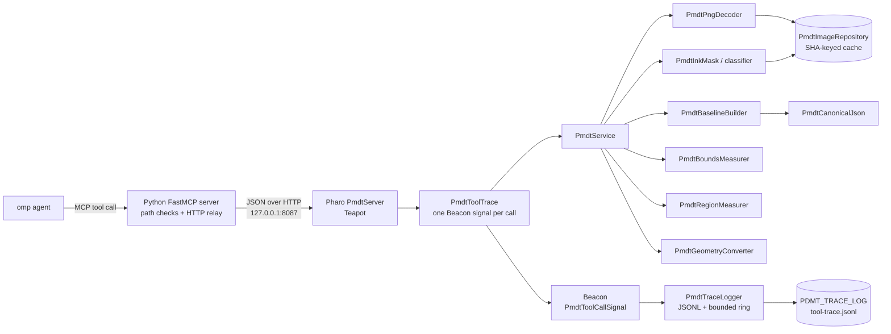

# PNG diagram measurement tool — implementation plan

Status: proposal (not implemented).

Implements `workflow/png_diagram_measurement_tool_plan_with_mask_and_tight_crop.md` (the **operation plan** below). Scope is exactly that document: `inspect_image`, `make_ink_mask`, `measure_bounds`, `measure_regions`, `normalize_geometry`, `create_baseline`. No TeX parsing, no image comparison, no connected components, no semantic labels.

## 1. Decisions

| Decision | Choice | Why |
|---|---|---|
| Where the work happens | All decoding, thresholding, geometry, and serialization run in the Pharo image. The MCP server is a transport shim only. | Satisfies "relayed to a Pharo image"; keeps one implementation of every measurement. |
| MCP surface | One MCP server exposing six measurement tools plus read-only `png_health` and `png_trace`. **Reject** the single `analyze_png_diagram` + `action` tool. | Typed per-tool schemas, required fields, tool-specific descriptions and annotations; matches `smalltalk-interop` (22 tools) and `smalltalk-validator` (5), not a monolith. |
| Pharo endpoint | A standalone Teapot server, `PmdtServer`, on port 8087, mirroring `SisServer` (`current`, `startUp:`, `teapot`, `returnResultDo:`). | No fork of the interop server; independent lifecycle; typed JSON endpoints instead of `/eval` code strings. |
| Image lifecycle | One-time `Metacello` load into a saved Pharo image, with `PmdtServer installStartup` registering `startUp:`/`shutDown:` in the image startup list. The server starts on every image boot, not per reconstruction. | `pharo ... eval` does not persist its changes; a snapshot plus startup-list registration makes the load durable and the server a managed service. |
| Tool trace | One Beacon signal per measurement request, consumed by a single `PmdtTraceLogger` that writes JSONL and keeps a bounded in-image ring. `GET /png/trace` and the `png_trace` MCP tool expose the ring. | Beacon is Pharo's logging bus; the trace supplies external call counts and outcomes without changing canonical results. |
| PNG input | A narrow custom decoder in Pharo using `ZLibReadStream`; strict 8-bit, non-interlaced subset. | `PNGReadWriter` ignores `pHYs` and does not expose the metadata or strict errors the operation plan requires. |
| Mask output | A custom 8-bit grayscale PNG writer in Pharo using `ZLibWriteStream` and `CRC`. | `PNGReadWriter` writes depth ≤ 8 as indexed colour (`colorType := 3`); the operation plan requires colour type 0 grayscale. |
| JSON output | `NeoJSONWriter` over recursively sorted `OrderedDictionary` maps, with a fixed float printer. | Deterministic key order and number formatting without a second serializer. |
| External tooling | No external image-processing binary or library at runtime. Pharo's built-in zlib, SHA-256, CRC-32, JSON, and Teapot are sufficient; the Python process is transport only. | The only hard external dependency would be PNG decoding, and Pharo supplies zlib. If a future operation needs PDF, rasterize outside and feed PNG. |
| Verification oracle | Generated fixture PNGs plus an independent Python decoder for the real target. Do not pin the operation-plan examples. | The operation-plan numbers are illustrative and do not match the current `reference/target.png` (see §10). |

### Why not one `analyze_png_diagram` tool

The operation plan's single action-dispatch tool is convenient to register but poor for a model-facing API: one schema cannot express per-action required fields, descriptions become generic, and annotations such as `readOnlyHint` cannot differ between inspect and baseline-write. The reference plugin already uses one MCP server per capability group with discrete tools. Keep that shape; put workflow guidance in a skill, not in the tool schema.

### Relationship to `smalltalk-dev-plugin`

The plugin repository is packaging (skills + `.mcp.json`), not the server implementation; its MCP entries launch two separate Python packages: `smalltalk-interop-mcp-server`, which relays to a Pharo or Squeak image, and `smalltalk-validator-mcp-server`. Mirror that split:

1. a Pharo package (`PngDiagramMeasure`) implementing the service and Teapot endpoints;
2. a Python FastMCP package (`png-diagram-measure-mcp-server`) that only relays HTTP;
3. an omp skill and `.omp/mcp.json` entry for discovery.

Develop both under `tools/png-measure/`; they can be split into two publishable repositories later without changing either side's contract.

## 2. Runtime architecture



One request path: MCP validates arguments, resolves the repo-relative and absolute image path, POSTs JSON to `/png/<operation>`, and returns the Pharo envelope unchanged. Pharo reads the file once, computes SHA-256, reuses cached pixels/masks when the SHA and mask parameters match, computes the result, and serializes canonical JSON. No image bytes cross into Python. Every measurement route wrapper emits exactly one `PmdtToolCallSignal` around dispatch; health and trace routes are outside the trace. The trace is a side channel and never alters the result envelope.

### Pharo facilities used

| Need | Facility (verified present in the local Pharo 13.1 image) |
|---|---|
| zlib inflate | `ZLibReadStream` (`Compression`) |
| zlib deflate | `ZLibWriteStream` (`Compression`) |
| SHA-256 | `SHA256 hashMessage:` (`System-Hashing`) |
| CRC-32 | `CRC crc32FromCollection:` (`System-Hashing`) |
| JSON input | `NeoJSONReader` |
| JSON output | `NeoJSONWriter` with `writeNil: true` and a fixed `floatPrinter:` |
| HTTP | `Teapot` |
| Logging bus | `Beacon` (`BeaconSignal` + `SignalLogger` from `Beacon-Core`; `MemoryLogger` is available but the trace uses a custom `SignalLogger`) |
| Coordinates | `Point` for points; `PmdtBBox` for exclusive boxes |

Important verified facts: `PNGReadWriter>>processPhysicalPixelChunk` is a no-op, so `pHYs` must be parsed separately; `PNGReadWriter>>nextPutImage:interlace:filter:` selects colour type 3 for depth ≤ 8, so the mask writer cannot use it. Beacon's `SignalLogger>>startFor:` registers with `Beacon instance when:send:to:` and `stop` unsubscribes; use `startFor: PmdtToolCallSignal` so the trace logger does not receive unrelated Beacon signals.

## 3. Layout and Pharo model

```text
tools/png-measure/
├── pharo/
│   ├── .project                      # srcDirectory: 'src'
│   └── src/
│       ├── .properties               # format: tonel
│       ├── BaselineOfPngDiagramMeasure/
│       ├── PngDiagramMeasure-Core/
│       └── PngDiagramMeasure-Tests/
├── mcp/
│   ├── pyproject.toml                # fastmcp, httpx
│   ├── png_diagram_measure_mcp_server/{__init__,core,server}.py
│   └── tests/{test_core,test_server}.py
└── README.md
.omp/mcp.json                         # project MCP registration
.omp/skills/png-diagram-measure/SKILL.md
schemas/png-measurement.schema.json
schemas/png-trace.schema.json
scripts/png-measure-install.sh        # one-time Metacello load + startup registration + snapshot
scripts/png-measure-start.sh          # long-lived headless service with trace env
scripts/png-measure-smoke.sh          # curl-based smoke test including trace
scripts/promote-baseline.sh           # validate + copy a baseline into reference/
```

Prefix all classes `Pmdt` to avoid collisions.

| Class | Responsibility |
|---|---|
| `PmdtBBox` | Immutable exclusive box `[x0,y0,x1,y1]`: `width`, `height`, `center`, `union:`, `intersect:`, `clippedTo:`, `containsPoint:`, `asArray`, validation. |
| `PmdtMaskParameters` | `background`, `method`, `threshold`, `sensitivityThresholds`; validation, sorted unique thresholds, cache key. |
| `PmdtPngHeader` | Width, height, bit depth, colour type, interlace, palette, `tRNS`, `pHYs`, `hasAlpha`. |
| `PmdtPngDecoder` | Signature/chunk/CRC validation, IHDR strictness, IDAT inflate, five filters, palette and transparency expansion, RGBA8 output. |
| `PmdtPngWriter` | 8-bit grayscale colour-type-0 PNG: IHDR, IDAT (`filter 0` scanlines), IEND, CRC-32. |
| `PmdtRgbaImage` | Immutable extent, RGBA `ByteArray`, header, source SHA-256. |
| `PmdtInkMask` | Extent, binary `ByteArray` (0/255), parameters, ink count/fraction, bounding box per threshold. |
| `PmdtLuminanceClassifier` | Alpha composite over background, integer luminance score, threshold comparison, bounding-box accumulators. |
| `PmdtBoundsMeasurer` | Canvas/ink boxes, margins, aspect ratios, tight-crop rule and reasons, centimetre sizes. |
| `PmdtRegionMeasurer` | Window validation, outward rounding, clipping, tight box, centre/size/aspect, sensitivity, edge-ring check. |
| `PmdtGeometryConverter` | Point/box conversions among `image_pixels`, `normalized_image`, `ink_pixels`, `normalized_ink`, `centimetres`; basis descriptors. |
| `PmdtCanonicalJson` | Recursive key sorting, fixed float formatting, LF/UTF-8 output. |
| `PmdtBaselineBuilder` | Assembles inspect + mask + bounds + regions into one canonical document. |
| `PmdtImageRepository` | SHA-keyed LRU for images and masks; mutex; no path-only cache. |
| `PmdtService` | Facade: one method per public operation; returns result dictionaries or raises `PmdtError`; contains no tracing. |
| `PmdtServer` | Teapot routes, lifecycle, startup-list registration (`installStartup`, `startUp:`, `shutDown:`), trace middleware, error envelope, request logging. |
| `PmdtSettings` | `PDMT_PORT` (8087), `PDMT_HOST` (127.0.0.1), `PDMT_OUTPUT_ROOT`, `PDMT_MAX_PIXELS` (50,000,000), cache sizes, `PDMT_AUTOSTART`, `PDMT_TRACE_LOG`, `PDMT_TRACE_ENTRIES`, `PDMT_TRACE_MAX_BYTES`. |
| `PmdtToolTrace` | Wraps one route dispatch: measures duration, derives `outcome` and warning codes, emits one `PmdtToolCallSignal` in `ensure:`, and re-raises the original error. |
| `PmdtToolCallSignal` | `BeaconSignal` subclass carrying `runId`, `sequence`, `phase`, `requestId`, `clientId`, `clientRole`, `tool`, `outcome`, `errorCode`, `warningCodes`, `durationMs`, `imagePath`, `imageSha256`, `regionCount`, `emptyRegionCount`, `outputWritten`, `resultBytes`; `asDictionary` for JSON. |
| `PmdtTraceLogger` | `SignalLogger` subclass registered for `PmdtToolCallSignal` only; owns a bounded `entries` ring, appends one JSON line per signal to `PDMT_TRACE_LOG` under a mutex, and rotates at `PDMT_TRACE_MAX_BYTES`. |
| `PmdtTraceReport` | Read-only aggregation over the ring: filters (`tool`, `clientId`, `sinceSequence`), counts by tool/outcome/client, and canonical JSON for `/png/trace`. |
| `PmdtError` | `code`, `message`, `details`. |
| `PmdtVersion` | `schemaVersion` (1) and `toolVersion` (`0.1.0`). |

Use `Point` for points; do not introduce a second point class. `PmdtBBox` deliberately does not use `Rectangle`, whose `right`/`bottom` conventions are inclusive and invite off-by-one errors.

### Image lifecycle

- `PmdtServer class>>installStartup` is idempotent: it adds `PmdtServer` to the image startup list and ensures the trace/output directories exist. It does not start Teapot and does not open the trace log, so the image can be snapshotted cleanly.
- `PmdtServer class>>startUp:` runs on every image boot. It reads `PDMT_AUTOSTART` (default `1`), and when enabled installs `PmdtTraceLogger` and starts Teapot on `PDMT_HOST`/`PDMT_PORT`. It is a no-op if the server is already running, so a second `startUp:` or a live reload cannot create a second listener or logger. If the port is bound by another process, `startUp:` logs the failure to stderr and leaves the image running rather than aborting boot. If trace-log setup fails, no Teapot listener is created and no partial logger is registered.
- `PmdtServer class>>shutDown:` stops Teapot, unregisters the Beacon logger, and closes the trace stream. It runs on image quit/save, which keeps the snapshot free of live sockets.
- The install script (`scripts/png-measure-install.sh`) performs the load, calls `installStartup`, and snapshots. The start script (`scripts/png-measure-start.sh`) boots that saved image. The server is never loaded per reconstruction iteration; only a Tonel source change requires a reinstall (or a live `st-import` followed by `PmdtServer restart`).

## 4. MCP surface

| MCP tool | Operation plan | Writes | Result keys |
|---|---|---|---|
| `png_inspect_image` | `inspect_image` | none | `image`, `resolution`, `warnings` |
| `png_make_ink_mask` | `make_ink_mask` | mask PNG under output root | `mask_id`, `mask_path`, `mask_sha256`, `mask_format`, `mask_encoding`, `method`, `threshold`, `background`, `ink_pixel_count`, `ink_fraction`, `ink_bbox_px`, `bbox_sensitivity`, `warnings` |
| `png_measure_bounds` | `measure_bounds` | none | `image_bbox_px`, `ink_bbox_px`, `image_size_px`, `ink_size_px`, `margins_px`, `aspect_ratio`, `tight_crop`, `physical_size_cm`, `basis`, `warnings` |
| `png_measure_regions` | `measure_regions` | none | `regions` (sorted by name), `basis`, `warnings` |
| `png_normalize_geometry` | `normalize_geometry` | none | `geometry`, `from`, `to`, `transformation`, `exact`, `warnings` |
| `png_create_baseline` | `create_baseline` | optional JSON under output root | `schema_version`, `tool_version`, `image`, `parameters`, `mask`, `bounds`, `regions`, `baseline_sha256`, `warnings` |
| `png_health` | — | none | `status`, `tool_version`, `port`, `output_root`, `cache`, `trace` |
| `png_trace` | — | none | `entries`, `counts`, `log`, `truncated` |

`png_trace` is read-only and accepts `limit` (default 50, maximum 500), `since_sequence`, `tool`, and `client_id`. `entries` are newest-first; `truncated` is true when the limit or ring dropped older entries. It returns the in-image ring, not the JSONL file. `png_health` and `png_trace` are infrastructure and are not traced at all; only the six measurement routes are. This keeps health polling from evicting measurement history or inflating counts, and keeps reading the trace from mutating it.

Tracing is a side channel: trace metadata never appears in a tool result envelope and never changes canonical JSON, hashes, or baselines.

Each `regions[name]` result contains `status` (`measured`, `empty`, `invalid`), `requested_bbox`, `requested_basis`, `requested_bbox_px`, `clipped`, `tight_bbox_px`, `tight_bbox_normalized_ink`, `center_px`, `center_normalized_ink`, `size_px`, `aspect_ratio`, `bbox_sensitivity`, and `warnings`.

Common inputs:

```text
image_path: repo-relative path; MCP resolves image_abs_path and rejects escapes
image_abs_path: absolute path sent by MCP; Pharo reads this and echoes image_path
output_root: absolute path sent by MCP from PDMT_OUTPUT_ROOT; Pharo writes only here
mask: {background:"#ffffff", method:"luminance", threshold:0.5,
       sensitivity_thresholds:[0.25,0.5,0.75]}   # optional, defaults shown
dpi_override: {x:180.0, y:180.0}                  # optional, trusted caller value
regions: {name:[x0,y0,x1,y1], ...}                # png_measure_regions, required
region_units: "normalized_ink" | "normalized_image" | "image_pixels"
image_sha256: required with image_pixels regions (must match the decoded file)
geometry: {type:"point"|"box", coordinates:[...]}
from, to: "image_pixels" | "normalized_image" | "ink_pixels" | "normalized_ink" | "centimetres"
output_path: optional path under the output root (png_create_baseline only)
```

`image_pixels` regions require `image_sha256`; a mismatch is an error, because pixel windows are tied to a specific raster. `png_create_baseline` accepts regions optionally; with no `output_path` it is read-only and returns the document. It computes the mask in memory and never exports a mask PNG; call `png_make_ink_mask` when the artifact is wanted. `mask_sha256` is always the SHA-256 of the canonical mask PNG bytes, whether or not a file is written.

The MCP shim sends trace-only headers: `X-PDMT-Request-Id` per call, `X-PDMT-Client-Id` per MCP process, and optional `X-PDMT-Client-Role` from `PDMT_CLIENT_ROLE`. They never affect measurement results; they exist so trace lines from multiple agents or sessions can be grouped.

Every response uses the interop server's envelope, extended with version fields:

```json
{"success": true, "schema_version": 1, "tool_version": "0.1.0", "result": {}}
```

```json
{"success": false, "schema_version": 1, "tool_version": "0.1.0",
 "error": {"code": "unsupported_bit_depth", "message": "...", "details": {}}}
```

Warnings are objects, not free strings:

```json
{"code": "region_ink_extends_beyond_window",
 "message": "Ink continues immediately left of the requested window",
 "details": {"region": "divider", "side": "left"}}
```

Stable codes: `dpi_unknown`, `dpi_override`, `background_not_light`, `no_ink`, `mostly_ink`, `bbox_unstable`, `threshold_unsuitable`, `region_clipped`, `region_empty`, `region_ink_extends_beyond_window`, `outside_basis`.

### Agent workflow (encoded in the skill)

1. `png_inspect_image` once per image; refuse to measure an unsupported PNG.
2. `png_measure_bounds` before any crop, margin, aspect, or physical-size claim.
3. `png_measure_regions` for named windows, normally `normalized_ink`; enlarge any window that triggers `region_ink_extends_beyond_window`.
4. `png_normalize_geometry` to turn explicit TeX coordinates into the same basis.
5. `png_create_baseline` once for `reference/target.png`; the coordinator promotes the result to `reference/target.measurements.json`.
6. Cite raw boxes, threshold, background, and basis with every number. Never describe a measurement as a semantic identification.
7. Use `png_trace` only to audit tool usage or answer a human question; it is not measurement evidence and is not part of the reconstruction loop.

## 5. Contracts and determinism

### Coordinates and rounding

- Raster origin top-left; `x` right, `y` down; boxes `[x0,y0,x1,y1]` with exclusive `x1`,`y1`; `width=x1-x0`, `height=y1-y0`.
- Normalized → pixel windows use **outward** rounding: `x0=floor(...)`, `y0=floor(...)`, `x1=ceil(...)`, `y1=ceil(...)`, then clip to the image. This removes the ambiguity in the operation-plan example and never hides ink at a window edge.
- Pixel → normalized uses exact division, rounded to 6 decimals; aspect ratios and centimetres to 4; DPI to 2. Threshold map keys use trimmed canonical decimals. All formatting goes through `PmdtCanonicalJson`; no ad-hoc `printString` in output.
- Luminance uses the operation-plan coefficients on encoded 8-bit values: score `2126R + 7152G + 722B` (range 0..2550000), ink when `score < threshold * 2550000`. Alpha composite uses integer floor: `(C*A + B*(255-A)) // 255`. No per-pixel `Color` objects.
- `sensitivity_thresholds` are sorted, de-duplicated, and unioned with the primary threshold; at most 9. Full-image sensitivity boxes are computed in the same decode/composite pass as the primary mask; each region's sensitivity boxes are computed in one pass restricted to that window.
- Tight crop compares real-valued margins (`margin <= max(3, 0.02*dimension)`), uses bounding-box coverage `(inkW*inkH)/(W*H)`, and treats `max edge displacement <= max(2, 0.005*max(W,H))` as stable. Reasons are emitted in fixed order: left, right, top, bottom, coverage, stability, no-ink.
- An empty primary mask is never tight: null boxes/sizes/aspects, zero coverage, `no_ink` warning. A region with no primary ink is `status:"empty"` with null geometry, not fabricated numbers.
- `outside_basis` is a warning, never a clamp. Centimetre output with unknown DPI is `null` plus `dpi_unknown`; it is not an error.

### Determinism

- Canonical JSON: UTF-8, LF, sorted object keys, fixed float formatting, no timestamps, no absolute paths, no run-varying identifiers.
- `image.path` is the caller's repo-relative path; `sha256` is lowercase hex of the file bytes. `mask_id = mask-<sha12>-<method>-<threshold>-<bg>`; the background is included because it changes the mask.
- Mask filename: `<safe-basename>.ink-mask.<sha12>.<method>.<threshold>.<bg>.png`; deterministic content for the same source, parameters, Pharo VM, and zlib build. A test writes it twice and compares bytes. Cross-version byte identity is not promised; if it becomes a requirement, replace zlib with stored deflate blocks at the cost of file size.
- Baseline JSON: `baseline_sha256` is the SHA-256 of the exact canonical baseline document with the `baseline_sha256` field omitted (no circular hash); it covers the baseline document, not the MCP envelope. The baseline records `image.sha256`, so a changed target is detectable rather than silently authoritative.

### Tool trace

- Every measurement route (`/png/inspect_image`, `/png/make_ink_mask`, `/png/measure_bounds`, `/png/measure_regions`, `/png/normalize_geometry`, `/png/create_baseline`) emits exactly one `PmdtToolCallSignal`, including requests that end in `PmdtError`. `PmdtToolTrace` wraps the dispatch in `ensure:` and re-raises the original error. `png_health` and `png_trace` are infrastructure and emit nothing, so health polling cannot evict measurement history and reading the trace cannot mutate it.
- `PmdtToolTrace` derives `outcome`: `ok` (success, no warnings), `ok_with_warnings`, or `error`. Pre-dispatch MCP rejections (path escape, missing argument) use `phase: "mcp"` and `outcome: "rejected"` in the same JSONL file; they are best-effort shim lines, not Beacon signals, because the image is never reached. They carry the shim's process/session ID as `run_id` and a local `sequence`; `/png/trace` counts only the in-image ring, while the JSONL file is the full stream including shim rejects. The shim appends with `O_APPEND` and one write per line so its lines do not interleave with the Pharo logger's.
- `PmdtToolCallSignal` subclasses `BeaconSignal` and is serialized as one JSON object per line:

```json
{"schema_version":1,"run_id":"...","sequence":42,"timestamp":"2026-11-10T12:34:56.789Z",
 "phase":"server","request_id":"...","client_id":"...","client_role":"reviewer",
 "tool":"png_measure_regions","outcome":"ok_with_warnings","error_code":null,
 "warning_codes":["region_empty"],"duration_ms":12.3,"image_path":"reference/target.png",
 "image_sha256":"...","region_count":4,"empty_region_count":1,
 "output_written":false,"result_bytes":731}
```

- `run_id` is generated once per image boot; `sequence` is monotonic within a run; the JSONL file can contain multiple runs, while the in-image ring resets on boot. `timestamp` is UTC ISO-8601 with milliseconds. Missing `X-PDMT-Client-Id`/`X-PDMT-Client-Role` values are recorded as `unknown`. `image_path` is the caller's repo-relative path; absolute paths and image bytes never appear. `result_bytes` is the size of the canonical result document, not the envelope.
- Trace data is intentionally non-deterministic (timestamps, durations, sequences, run/client IDs). It is never included in canonical JSON, baselines, or byte-stability tests.
- `PmdtTraceLogger` is a `SignalLogger` subclass registered for `PmdtToolCallSignal` only, installed once by `PmdtServer startUp:` and stopped by `PmdtServer shutDown:`. It owns the bounded `entries` ring used by `/png/trace`. Re-registering is idempotent so a live `st-import` reload does not duplicate loggers or lines. The MCP shim resolves a relative `PDMT_TRACE_LOG` against `PDMT_REPO_ROOT` before appending its own pre-dispatch lines.
- Sinks: `PDMT_TRACE_LOG` (default `tmp/png-measure/tool-trace.jsonl`) is opened in append mode, one JSON object per line, flushed after each line, and rotated to `.1` when `PDMT_TRACE_MAX_BYTES` (default 5,000,000) is exceeded. The in-image ring is capped at `PDMT_TRACE_ENTRIES` (default 1000) for `/png/trace`; trimming and file writes share one mutex because Teapot may serve concurrently.
- `PmdtTraceReport` counts the ring entries (all are measurement calls) and returns:

  ```json
  {"total":42,
   "by_tool":{"png_measure_bounds":12,"png_measure_regions":18,"png_inspect_image":3,
              "png_make_ink_mask":2,"png_normalize_geometry":4,"png_create_baseline":3},
   "by_outcome":{"ok":30,"ok_with_warnings":9,"error":3},
   "by_warning":{"region_empty":3,"bbox_unstable":6},
   "by_client":{"pmdt-...":42},
   "log":{"path":"tmp/png-measure/tool-trace.jsonl","entries":42,"bytes":12345}}
  ```

  `by_warning` counts warning occurrences, not calls. Counts cover the current ring (the last `PDMT_TRACE_ENTRIES` calls); the JSONL file is the lifetime record. "Usefulness" is not a server verdict; the counts, `outcome`, `warning_codes`, `empty_region_count`, and `output_written` give an external agent the evidence to judge it.
- If the trace log cannot be opened at startup, `PmdtServer startUp:` refuses to start Teapot, reports `trace_unavailable` on stderr, and leaves the image booting; the trace is part of the service contract. A later write failure is caught by `PmdtTraceLogger`, reported as `trace.status: "degraded"` in `png_health`, and never changes the measurement result. `PmdtToolTrace` also guards `Beacon announce:` itself, so a faulty logger cannot replace the real `PmdtError` or turn a success into a failure.
- External access is headless-safe through three surfaces:

  | Surface | Read from | Scope |
  |---|---|---|
  | JSONL file | `tail -f`, `jq`, or an external process | Durable full stream across image restarts |
  | `GET /png/trace` | `curl` on loopback; SSH-forward or Docker port mapping remotely | Live in-image ring and counts |
  | `png_trace` MCP tool | An agent with neither shell nor filesystem access | Live in-image ring and counts |

  `png_health` reports `trace: {status, log_path, entries, bytes}`. A quick external count is `jq -r 'select(.phase=="server") | .tool' tmp/png-measure/tool-trace.jsonl | sort | uniq -c`. Beacon's `TranscriptLogger` is optional for interactive debugging; it is not a headless transport and is never the authoritative trace. The JSONL sink and `/png/trace` are.

### Caching

- Images keyed by SHA-256; masks keyed by `(SHA, background, method, threshold, sensitivity_thresholds)`. Bounded LRU (defaults: 4 images, 8 masks), guarded by a mutex because Teapot may serve concurrently.
- Cache is an optimization only; a miss must reproduce identical output. No path+mtime cache that could return stale pixels after a file replacement.

### Errors and limits

| Code | Condition |
|---|---|
| `invalid_request` | Missing/wrong field, malformed region/geometry, too many regions |
| `image_not_found` | Path missing or not a regular file |
| `path_outside_repo` | Image or output path escapes the configured root |
| `image_too_large` | File or `width*height` above configured limit |
| `not_a_png`, `truncated_png`, `invalid_chunk`, `crc_mismatch` | Signature/chunk/CRC failures |
| `unsupported_bit_depth`, `unsupported_interlace`, `unsupported_color_type` | Outside the declared PNG subset |
| `decompression_failed`, `trailing_idat_data` | Bad deflate stream or size mismatch |
| `unknown_basis`, `invalid_region`, `sha_mismatch` | Coordinate/region contract violations |
| `output_path_rejected` | Write outside the configured output root |
| `trace_unavailable` | `PDMT_TRACE_LOG` cannot be opened or created at startup |

HTTP status: 200 success, 400 invalid request, 404 image, 422 unsupported PNG, 500 internal. The MCP client parses a JSON body even on 4xx/5xx so the envelope is preserved. Stack traces are logged, not returned, unless `PDMT_DEBUG=1`.

### Security and artifacts

- `PmdtServer` binds `127.0.0.1` by default; no authentication; do not expose it. This applies to `/png/trace` as well.
- All writes go under `PDMT_OUTPUT_ROOT` (default `tmp/png-measure/`), are atomic (temp + rename), and reject `..`, absolute escapes, and symlinks leaving the root. `PDMT_TRACE_LOG` must resolve under the output root.
- The trace log is gitignored, records tool usage rather than measurement content, and contains no absolute paths or image bytes. It is still local operational data; do not publish it without review.
- `PDMT_TRACE_LOG` must resolve to the same file for the Pharo process (start script) and the MCP shim (`.omp/mcp.json`); otherwise the JSONL stream is split across two files. The default in both places is `<repo>/tmp/png-measure/tool-trace.jsonl`.
- The Reviewer may call read-only tools (`png_inspect_image`, `png_measure_bounds`, `png_measure_regions`, `png_normalize_geometry`, `png_create_baseline` without `output_path`, `png_health`, `png_trace`). Mask cache and trace writes are confined to the gitignored output root. The coordinator alone promotes a baseline into `reference/`.

## 6. Implementation phases

### Phase 0 — scaffold and contracts

Deliver `.project`, Tonel packages, `BaselineOfPngDiagramMeasure` (NeoJSON + Teapot dependencies; `Beacon-Core` is already in the Pharo 13.1 image and is not fetched externally), `PmdtBBox`, `PmdtMaskParameters`, `PmdtError`, `PmdtCanonicalJson`, `PmdtVersion`, and the test fixture factory. Add `PmdtServer` skeleton, `PmdtServer installStartup`/`startUp:`/`shutDown:`, `/png/health`, and the `PmdtToolCallSignal`/`PmdtTraceLogger` skeleton.

Acceptance: package imports into a clean Pharo 13 image; `st-lint` passes; SUnit green; canonical JSON byte-stable across two runs; `curl /png/health` returns the envelope. After `PmdtServer installStartup` and an image snapshot, a new image boot starts the server without a manual `eval`; `PDMT_AUTOSTART=0` suppresses it; a second start does not create a second listener or logger; `/png/health` reports trace status, and a synthetic `PmdtToolCallSignal` writes exactly one JSONL line.

### Phase 1 — decode, inspect, mask, bounds

Deliver `PmdtPngHeader`, `PmdtPngDecoder`, `PmdtPngWriter`, `PmdtRgbaImage`, `PmdtInkMask`, `PmdtLuminanceClassifier`, `PmdtBoundsMeasurer`, `PmdtService` for inspect/mask/bounds, and `PmdtImageRepository`.

Acceptance: fixture PNGs for colour types 0/2/3/4/6 decode correctly; 16-bit and Adam7 are rejected with the declared codes; CRC and truncation failures are explicit; mask PNG is `8-bit grayscale`, same dimensions, only 0/255, round-trips; target smoke matches §10; tight-crop reasons are exact and ordered.

### Phase 2 — regions and conversion

Deliver `PmdtRegionMeasurer`, `PmdtGeometryConverter`, and the corresponding service methods.

Acceptance: outward rounding, clipping, `normalized_image`/`normalized_ink`/`image_pixels` regions, SHA guard, sensitivity boxes, edge-ring warnings, empty/invalid regions, point/box conversions, `outside_basis`, and unknown-DPI nulls all have unit tests. No connected-component output exists.

### Phase 3 — baseline, server, MCP, workflow

Deliver `PmdtBaselineBuilder`, `PmdtToolTrace`, `PmdtTraceReport`, all Teapot routes including `/png/trace`, the FastMCP server, `.omp/mcp.json`, the skill, the `png_trace` tool, `scripts/png-measure-install.sh`, `scripts/png-measure-start.sh`, `scripts/png-measure-smoke.sh`, `scripts/promote-baseline.sh`, `schemas/png-measurement.schema.json`, `schemas/png-trace.schema.json`, and documentation. Update the generator and reviewer agent prompts with the measurement workflow and citation rule.

Acceptance: `curl` end-to-end for every route; MCP tools visible via `/mcp list`; a subagent can call `png_measure_bounds` without Bash or `eval`; baseline run twice is byte-identical; `reference/target.measurements.json` is generated, validated, and records the target SHA-256. Every measurement call produces one JSONL line; `png_trace` reports correct `by_tool` and `by_outcome` counts; `png_health` and `png_trace` do not inflate measurement counts; `tail -f` and `curl /png/trace` both work while the image is headless.

### Phase 4 — hardening

Add malformed-PNG fuzz cases, max-pixel/decompression guards, decoder cross-check against `PNGReadWriter`, performance measurements for 696×252 and 1530×1980, cache eviction tests, trace rotation/concurrency/failure tests, and CI (Pharo image + SUnit + Python tests + install/save/reboot smoke + curl smoke).

## 7. Test plan

| Layer | Cases |
|---|---|
| PNG decoder | 5 colour types, all five filters, palette + `tRNS`, gray/RGB `tRNS`, `pHYs` unit 1 and 0, multiple IDAT chunks, ancillary chunks; reject 16-bit, Adam7, bad signature, bad CRC, truncated IDAT, unknown critical chunk, oversize dimensions |
| Mask | Transparent black over white is background; opaque black is ink; threshold boundary at exactly the limit; no-ink and mostly-ink warnings; sensitivity boxes monotone with threshold; deterministic mask bytes |
| Bounds | Empty mask; exact margin limit equality; coverage equality; stability limit equality; reason order; DPI unknown/override; x/y DPI differ |
| Regions | Outward rounding (including the operation-plan's inconsistent example), clipping, zero-area/inverted boxes, empty region, threshold with no ink, edge-ring warning on each side, SHA mismatch |
| Conversion | Round-trip point/box for every pair of bases; outside-basis warning; centimetres with metadata/override/unknown DPI; `exact` semantics |
| Canonical JSON | Sorted keys at all depths, nil as `null`, fixed floats, LF/UTF-8, no timestamps; two runs identical |
| MCP server | Mocked `httpx`; endpoint/payload per tool; JSON error passthrough; path normalization; tool registration/annotations |
| Trace | Exactly one line per measurement call including errors; `png_health` and `png_trace` untraced; `by_tool`/`by_outcome`/`by_warning`/`by_client` counts; filters and `since_sequence`; JSONL append/flush/rotation; mutex under concurrent requests; logger idempotence across start/stop; no change to canonical result bytes; MCP pre-dispatch `phase:"mcp"` line |
| Integration | Real `reference/target.png` and `current/reconstruction.png` when present; SUnit skip otherwise; Pharo server + curl + MCP call; baseline hash; install + snapshot + reboot retains the package and auto-starts `PmdtServer`; `PDMT_AUTOSTART=0` suppresses startup; trace file and `/png/trace` readable from outside the headless image |

Independent oracle: decode the real target with a small Python zlib decoder and compare RGBA/bbox/ink counts. Pin exact values in tests only after the Pharo implementation reproduces the oracle within ±1 pixel/count; the operation-plan examples are not test data.

Do **not** use `PNGReadWriter` + `Form>>colorAt:` for pixel-level golden values. On the target it reproduced the ink bbox but 9,624 pixels differed from the raw 8-bit samples by up to 66 levels (its colour-managed channels shift threshold-edge pixels; the threshold-0.5 count was 11,315 instead of 9,544). Use it only for structural checks such as dimensions, form depth, and bbox.

## 8. Workflow integration

`.omp/mcp.json` (project scope; works for subagents without granting Bash/eval):

```json
{
  "mcpServers": {
    "png-diagram-measure": {
      "command": "uv",
      "args": ["--directory", "tools/png-measure/mcp",
               "run", "png-diagram-measure-mcp-server"],
      "env": {"PDMT_PORT": "${PDMT_PORT:-8087}",
              "PDMT_REPO_ROOT": "${PDMT_REPO_ROOT:-.}",
              "PDMT_TRACE_LOG": "${PDMT_TRACE_LOG:-tmp/png-measure/tool-trace.jsonl}",
              "PDMT_CLIENT_ROLE": "${PDMT_CLIENT_ROLE:-}"}
    }
  }
}
```

- Add `tmp/png-measure/` to `.gitignore`. The trace log and mask cache both live there; neither is committed.
- Add `.omp/skills/png-diagram-measure/SKILL.md` with the workflow and citation rules from §4. Include `name` and `description` frontmatter; omp discovers project skills one level under `.omp/skills/`. State that `png_trace` is diagnostic: use it to audit tool usage or answer a human question, never as measurement evidence, and never call it in the measurement loop.
- Add a short measurement paragraph to `.omp/agents/diagram-generator.md` and `.omp/agents/diagram-reviewer.md`: use the tools before geometry claims; cite `threshold`, `background`, raw box, and basis; treat warnings as evidence that a window or threshold is wrong.
- Generate `reference/target.measurements.json` once and check it in. A review that sees a different `image.sha256` must regenerate it; a stale baseline is a warning, not authority. The coordinator uses `scripts/promote-baseline.sh`, which validates the schema and copies the file; the measurement server never writes into `reference/`.
- Document the image lifecycle in `README.md`: install once with `scripts/png-measure-install.sh` (load, `PmdtServer installStartup`, snapshot), then start the saved image once per boot as a service with `scripts/png-measure-start.sh`. Do not reload per reconstruction; reinstall only when the Tonel source changes. A dedicated image copy is recommended; if the image also hosts `SisServer`, both startup entries run on boot and must use distinct ports (8087 for PDMT, 8086 or the configured `PHARO_SIS_PORT` for SisServer).
- Document trace access in `README.md`: `tail -f tmp/png-measure/tool-trace.jsonl`, `curl -s 'http://127.0.0.1:8087/png/trace?limit=50'`, or the `png_trace` MCP tool. For a remote or Dockerized image, bind-mount `tmp/png-measure/` or forward port 8087 with SSH (`ssh -L 8087:127.0.0.1:8087 ...`); the trace file is the durable, headless-safe surface, while `/png/trace` is the live in-image ring. For distribution, replace the local `uv --directory` entry with `uvx --from git+https://github.com/<owner>/png-diagram-measure-mcp-server.git png-diagram-measure-mcp-server`, matching the plugin's `.mcp.json` style.

Concrete local install and smoke commands (paths are examples; the VM path is installation-specific). The install command deliberately ends with a snapshot: `pharo ... eval` exits and discards in-memory changes, so without the snapshot the next boot starts the previous image and both `PngDiagramMeasure` and `PmdtServer` are absent. The start command runs the saved image once per boot, not per reconstruction; use a service manager in production. An image that is already running cannot be opened by a second VM; stop the service before reinstall, or load and save through the live image (`st-import` route).

```bash
PHARO=~/pharo-launcher/pharo-vm/pharo
IMAGE=~/Pharo/images/PngMeasure/PngMeasure.image   # dedicated copy recommended
REPO=/home/gcorsi/code/circuitikz-agent-loop-template

# One-time install. Copy the base .image and .changes together; keep the matching .sources available.
PDMT_AUTOSTART=0 PDMT_PORT=8087 "$PHARO" --headless "$IMAGE" eval \
  "Metacello new baseline: 'PngDiagramMeasure'; repository: 'tonel://$REPO/tools/png-measure/pharo/src'; load.
   PmdtServer installStartup.
   Smalltalk snapshot: true andQuit: true"

# Start the saved image once per boot. Do not run this per reconstruction.
PDMT_AUTOSTART=1 PDMT_PORT=8087 \
PDMT_OUTPUT_ROOT="$REPO/tmp/png-measure" \
PDMT_TRACE_LOG="$REPO/tmp/png-measure/tool-trace.jsonl" \
  "$PHARO" --headless "$IMAGE" &

curl -s http://127.0.0.1:8087/png/health
curl -s 'http://127.0.0.1:8087/png/trace?limit=20'
tail -f "$REPO/tmp/png-measure/tool-trace.jsonl"
```

## 9. Deferred

- Image comparison and deltas (`compare_image`, baseline comparison) — the operation plan explicitly stops at baseline creation. A future tool must validate schema/tool version, image SHA-256, mask parameters, and region units before computing deltas.
- Connected components, automatic element labeling, and semantic identification — intentionally excluded.
- Caller-defined `drawing_bbox`, PDF input, non-luminance masks, adaptive thresholds, edge-based masks, paths/polygons/rotated boxes, 16-bit PNG, Adam7.
- TeX source parsing and CircuitTikZ symbol geometry.

## 10. Grounding evidence

The operation-plan JSON examples are illustrative, not measurements of the current target. An independent decode of `reference/target.png` (696×252, RGBA, 8-bit, non-interlaced, `pHYs` 4724 px/m ≈ 119.99 dpi) gives:

| Quantity | Operation-plan example | Current target (threshold 0.5) |
|---|---|---|
| Ink bbox px | `[12, 9, 685, 243]` | `[16, 13, 684, 241]` |
| Ink pixels | 18462 | 9544 |
| Ink fraction | 0.1053 | 0.0544 |
| Margins L/T/R/B px | 12/9/11/9 | 16/13/12/11 |
| Ink size px | 673×234 | 668×228 |
| Image / ink aspect | 2.7619 / 2.8761 | 2.7619 / 2.9298 |
| Bounding-box coverage | 0.898 | 0.8684 |
| Tight crop | false | false (left, top, bottom, coverage) |
| Sensitivity boxes 0.25/0.50/0.75 | `[13,10,684,242]`, `[12,9,685,243]`, `[11,8,686,244]` | `[16,14,684,241]`, `[16,13,684,241]`, `[16,13,684,241]` |

Consequences: (1) tests must derive expected values from an oracle, not copy the examples; (2) the operation-plan's `requested_bbox_px` uses inconsistent rounding (`322` for 321.58, `376` for 375.42) — hence the explicit floor/ceil rule in §5; (3) the plan's operation numbering skips 6 before `create_baseline`; this plan treats baseline as operation 6; (4) `PNGReadWriter` is not a pixel-level oracle: it reproduced the bbox but its `Form>>colorAt:` values differed from raw sRGB on 9,624 pixels (max difference 66), so the custom raw-byte decoder is authoritative for luminance and counts.

## 11. Definition of done

1. All 16 acceptance criteria in the operation plan have a named SUnit or integration test.
2. The Pharo package loads into a clean Pharo 13 image with only declared dependencies, `PmdtServer installStartup` registers the startup hook, the image is snapshotted, and a subsequent boot starts the server without a manual `eval`.
3. `PNGReadWriter` is not used in production; it is a structural cross-check only (its `colorAt:` is not a pixel-level oracle).
4. Every response echoes schema/tool version, mask parameters, DPI source, and coordinate basis.
5. `reference/target.measurements.json` is reproducible byte-for-byte and records the target SHA-256.
6. The generator and reviewer can call the tools through omp MCP with Bash and `eval` still denied.
7. The mask PNG is grayscale colour type 0 with identical dimensions and only 0/255 values.
8. No output contains connected components, inferred element names, or semantic verdicts.
9. Every measurement call emits exactly one Beacon trace event; the JSONL file is readable while the image is headless; `png_trace` reports counts by tool/outcome/client; `png_health` and `png_trace` do not inflate those counts; tracing never changes canonical results or baseline hashes.
